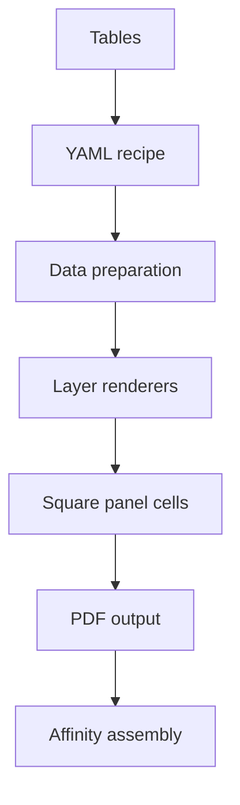

# CATPlot: the complete working tutorial

This tutorial takes you from installation to deliberate, repeatable panel
production. Work through sections 1–6 once in order. The later sections are a
reference you can return to when a plot becomes unusual.

## 1. The mental model

CATPlot keeps four concerns separate:

1. **Data** are ordinary tables. Column names carry meaning.
2. **A recipe** declares sources, layers, axes, layout, and output policy.
3. **The backend** turns that declaration into Matplotlib artists under a
   central style.
4. **Affinity** assembles the resulting panels with non-plot assets and exports
   the manuscript figure.

The useful unit is a *layer*. A line, uncertainty band, reference line, and text
annotation are four independent layers on the same panel. A panel owns axes,
legend, and colourbar policy. A layout arranges one or more panels. This avoids
having one enormous function for every possible combination.



The backend never requires a full Python script per plot. The YAML contains
only decisions specific to that plot. Imports, object construction, output
policy, and consistency checks stay in the package.

## 2. Install and create a project

Python 3.10 or newer is required. From the unpacked CATPlot directory:

```bash
python -m venv .venv
source .venv/bin/activate                 # Windows: .venv\Scripts\activate
python -m pip install --upgrade pip
python -m pip install -e .
```

`-e` installs in editable mode. Changes to the backend take effect without
reinstalling, which is convenient while the library is still evolving.

Create the stable project layout:

```bash
catplot init ~/work/my-paper
cd ~/work/my-paper
```

```text
my-paper/
├── data/
│   ├── raw/                 untouched inputs
│   └── derived/             deliberately processed tables
├── plots/
│   ├── recipes/             working YAML recipes
│   ├── draft/               replaceable render output
│   └── final/               safeguarded PDF/YAML/lock bundles
├── assets/
│   ├── vesta/
│   ├── vmd/
│   └── schematics/
└── affinity/                composite source and exports
```

Keep raw data immutable. If a scientific transformation changes the actual
analysis, do it upstream and write `data/derived/`. Use recipe transforms for
presentation-level operations that should be recorded next to the plot, such as
unit scaling or smoothing a displayed guide.

## 3. The fast path: one command, one panel

Every registered plot type automatically becomes a subcommand. To see the
catalog:

```bash
catplot inspect
catplot inspect line
catplot inspect heatmap
```

Create a grouped line plot:

```bash
catplot line data/raw/transport.csv \
  --x temperature \
  --y conductivity \
  --group-by compound \
  --marker o \
  --markersize 3.5 \
  --x-label "Temperature (K)" \
  --y-label "Conductivity (S cm⁻¹)" \
  --output conductivity
```

Two files result:

- `plots/recipes/conductivity.plot.yaml` is the editable source of truth.
- `plots/draft/conductivity.pdf` is a disposable preview.

The command is not ephemeral: it creates the recipe before rendering. For
several y columns, repeat a mapping flag:

```bash
catplot line data/raw/dos.csv \
  --x energy --y s --y p --y d \
  --x-label "Energy (eV)" --y-label "DOS" \
  --output orbital-dos
```

For a z-coloured scatter plot:

```bash
catplot scatter data/raw/samples.csv \
  --x pressure --y conductivity --color-by temperature \
  --marker-by phase --size-by confidence \
  --cmap plasma --colorbar-label "Temperature (K)" \
  --output phase-map
```

Here a numeric `color` column creates a continuous colourmap and colourbar. A
text `color` column uses deterministic categorical colours and a text `marker`
column uses deterministic symbols. This implements x/y/z/categorical encoding
without adding a distinct plot family for every permutation.

Quick commands are best for exploration and ordinary single panels. Once you
need multiple layers, dual axes, elaborate ticks, or several panels, edit the
generated YAML or begin from an example recipe.

## 4. Read a recipe from the outside in

This is the smallest useful recipe:

```yaml
schema: 1
style: {profile: paper, theme: default}
layout: {type: single, edge_mm: 85}

data:
  transport:
    path: ../../data/raw/transport.csv

panels:
  - id: main
    axes:
      x: {label: Temperature (K)}
      y: {label: Conductivity (S cm$^{-1}$)}
    legend: {frameon: false}
    layers:
      - type: line
        data: transport
        mapping: {x: temperature, y: conductivity, group: compound}
        options: {marker: o}

output:
  name: conductivity
  directory: ..
  formats: [pdf]
  preview_dpi: 180
  final_dpi: 600
```

Paths are relative to the recipe, not to the terminal's current directory.
This is why recipes remain predictable when called from a script or another
folder.

`mapping` connects semantic roles understood by a renderer to table columns.
`options` changes how that renderer draws. The distinction is important:
`mapping: {color: temperature}` means data drive colour, while
`options: {color: '#332288'}` means one fixed colour.

Render and temporarily override one value without editing the file:

```bash
catplot render plots/recipes/conductivity.plot.yaml
catplot render plots/recipes/conductivity.plot.yaml \
  --set panels.0.axes.y.limits='[0, 1.5]'
```

Override values are parsed as YAML, so numbers, booleans, lists, and mappings
retain their types. Treat `--set` as a comparison tool; commit the accepted
decision into the recipe.

## 5. Drafts, finals, and reproducibility

Normal rendering is intentionally quiet:

```bash
catplot render plots/recipes/conductivity.plot.yaml
```

It replaces the PDF in `plots/draft/` and does **not** create a lock file. Use
the final flag only after inspection:

```bash
catplot render plots/recipes/conductivity.plot.yaml --final
```

The folder `plots/final/conductivity/` then contains:

| File | Purpose |
|---|---|
| `conductivity.pdf` | final PDF; vector where possible, 600 dpi for rasterized artists |
| `conductivity.plot.yaml` | portable, human-readable recipe with rebased data paths |
| `conductivity.plot.lock.json` | exact resolved recipe, source SHA-256 hashes, sizes and timestamps, command, Python/platform, and package versions |

The YAML is the document a human should read. The lock is a verification
artifact, not a second configuration interface. Do not edit it. If the input
table changes, render a new final and keep it as a new scientific state rather
than overwriting a previously submitted result.

The final DPI does not rasterize all output. Lines, text, markers, and paths stay
vector in PDF. Dense heatmaps default to rasterized because millions of vector
cells make Affinity slow and the PDF enormous. Their effective raster
resolution is 600 dpi in a final render.

## 6. Multi-panel figures without manual alignment

Each layout cell has a physical square edge, 85 mm unless overridden. A single
panel is therefore an exact 85 × 85 mm PDF. A three-panel vertical stack with
62 mm cells is a 62 × 186 mm block. The block is not square; each constituent
panel allocation is. This makes spacing and alignment deterministic while
retaining sensible composite geometry.

### Vertical DOS stack

```yaml
layout:
  type: stack
  direction: vertical
  cell_edge_mm: 62
  share_x: true
  share_y: true
  ratios: [1, 1, 1]
```

Then define panels in display order. Shared x axes hide upper x labels and
ticks automatically. Set the x label only on the lowest panel. Use identical y
limits when curves must be visually comparable. The complete working version
is `examples/tutorial_project/plots/recipes/dos-stack.plot.yaml`.

### Horizontal pair

```yaml
layout:
  type: stack
  direction: horizontal
  cell_edge_mm: 72
  share_y: true
```

### Regular grid

```yaml
layout:
  type: grid
  rows: 2
  columns: 2
  cell_edge_mm: 70
  share_x: false
  share_y: false
  width_ratios: [1, 1.2]
  height_ratios: [1, 1]
```

### Named mosaic

Repeated identifiers span cells:

```yaml
layout:
  type: mosaic
  cell_edge_mm: 60
  mosaic:
    - [overview, overview]
    - [detail_a, detail_b]
```

Panel IDs must match mosaic names exactly. Do not repeat a panel definition
when its mosaic ID repeats.

`panel_label: a` in an axes block places a consistent bold label just outside
the top left. This is preferable to adding panel letters manually in Affinity,
because the panel and letter cannot drift apart during revision.

## 7. Layers and encodings

The core renderer families are deliberately orthogonal.

| Family | Types | Required mappings |
|---|---|---|
| Cartesian | `line`, `scatter`, `errorbar`, `band`, `area`, `step`, `stem`, `colored-line` | see `catplot inspect TYPE` |
| Categorical | `bar`, `box`, `violin`, `strip`, `swarm` | usually `x`, `y` |
| Distribution | `histogram`, `density`, `ecdf` | `x` |
| 2D fields | `heatmap`, `contour`, `quiver`, `stream` | `x`, `y`, then scalar/vector roles |
| 3D | `line3d`, `scatter3d`, `surface`, `wireframe` | `x`, `y`, `z` |
| Annotation | `reference`, `span`, `text`, `arrow` | varies; reference/span use options only |

Common patterns follow.

### Line plus uncertainty band

```yaml
layers:
  - type: band
    data: measurements
    mapping: {x: temperature, lower: lower95, upper: upper95}
    options: {color: '#332288', alpha: 0.18}
  - type: line
    data: measurements
    mapping: {x: temperature, y: mean}
    options: {color: '#332288', label: Mean}
  - type: scatter
    data: measurements
    mapping: {x: temperature, y: observed}
    options: {color: '#111111', size: 14, label: Experiment}
```

Order is drawing order. Put backgrounds and bands first, lines next, and
markers/annotations last. Explicit `zorder` remains available when layers must
cross that convention.

### Multiple y columns

```yaml
- type: line
  data: dos
  mapping: {x: energy, y: [s, p, d]}
```

This is shorter than three layers when all series share options. Use separate
layers when each curve needs a semantic colour or linestyle.

### Grouped data

```yaml
mapping: {x: temperature, y: conductivity, group: compound}
```

Groups are emitted in stable order of appearance. Each receives the next theme
colour. A supplied `label` overrides automatic labels where supported.

### Continuous colour and categorical symbols

```yaml
- type: scatter
  data: samples
  mapping:
    x: pressure
    y: conductivity
    color: temperature
    marker: phase
    size: confidence
  options:
    cmap: plasma
    size_min: 10
    size_max: 55
    colorbar_label: Temperature (K)
```

Numerical colour data use `linear`, `log`, `symlog`, or `centered`
normalization. Set `vmin` and `vmax` for comparisons across panels; use
`center: 0` with `norm: centered` for signed residuals.

### Reference layers

Reference and span layers do not require a data source:

```yaml
- type: reference
  options: {axis: x, value: 0, linestyle: '--', label: E$_F$}
- type: span
  options: {axis: x, minimum: 1.2, maximum: 1.8, color: '#DDCC77'}
```

Text and arrows are data-driven so many annotations can come from a compact
table rather than a YAML list.

## 8. Axes, ticks, legends, colourbars, and right y axes

An axes block can control labels, scales, limits, tick locators, a light grid,
square data aspect, and 3D view:

```yaml
axes:
  title: Optional panel title
  x:
    label: Frequency (THz)
    limits: [0, 12]
    scale: linear
    ticks: {step: 2, minor: 1, format: '%.0f'}
  y:
    label: Lifetime (ps)
    scale: {type: log, base: 10}
    ticks: {max_count: 5}
  grid: {alpha: 0.15, linewidth: 0.5}
```

Tick controls are mutually prioritised: `values`, then `step`, then
`max_count`. `minor: 1` inserts one minor interval between adjacent major
ticks; a non-integer numeric value is treated as a fixed minor step.

Legends deduplicate identical labels across layers and both y axes:

```yaml
legend: {loc: upper left, frameon: false, ncols: 2}
```

Set `legend: false` to suppress it. A colour-producing layer owns whether a
colourbar exists; the panel owns placement:

```yaml
colorbar: {label: Energy (eV), shrink: 0.82, pad: 0.03}
```

For two y scales, assign a layer to `axis: right` and declare right-axis
settings:

```yaml
axes:
  x: {label: Temperature (K)}
  y: {label: Conductivity (S cm$^{-1}$)}
  right_y:
    label: Seebeck coefficient (µV K$^{-1}$)
    limits: [100, 300]
    scale: linear
layers:
  - type: line
    data: transport
    mapping: {x: temperature, y: conductivity}
    options: {color: '#332288', label: Conductivity}
  - type: line
    axis: right
    data: transport
    mapping: {x: temperature, y: seebeck}
    options: {color: '#CC6677', label: Seebeck}
```

Use dual axes sparingly. They are defensible when both variables share an
independent coordinate and the visual relation matters; otherwise use aligned
stacked panels.

## 9. Data loading, filtering, and recorded transforms

Known suffixes select CSV, TSV, whitespace (`.txt`, `.dat`), Excel, Parquet,
Feather, or JSON readers. Excel and columnar formats may need the optional
extras:

```bash
python -m pip install -e '.[io]'
```

Loading options are explicit:

```yaml
data:
  source:
    path: ../../data/raw/result.tsv
    format: tsv
    load:
      comment: '#'
      decimal: '.'
      columns: [temperature, conductivity, compound]
```

Structured filters combine with logical AND:

```yaml
filters:
  - {column: temperature, op: between, value: [300, 500]}
  - {column: compound, op: in, value: [PSe4, SbSe4]}
```

Available operations are `eq`, `ne`, `lt`, `le`, `gt`, `ge`, `between`, `in`,
`not_in`, `contains`, `isna`, and `notna`.

Transforms execute in order on a copy of the table:

```yaml
transforms:
  - {op: sort, by: temperature}
  - {op: scale, column: conductivity, output: conductivity_mS, factor: 1000}
  - {op: smooth, column: conductivity_mS, output: guide, method: savgol, window: 5, polyorder: 2}
  - {op: derivative, column: guide, output: slope, x: temperature}
```

Operations include `scale`, `clip`, `normalize`, `smooth`, `derivative`,
`cumulative`, `sort`, and `rename`. Normalization modes are `max_abs`, `max`,
`sum`, `area`, `zscore`, and `minmax`; area mode requires an x column.

If a transform could alter a scientific conclusion, preserve the untransformed
points as a visible layer and make the transformed curve visually identifiable
as a guide.

## 10. 2D scalar and vector fields

A complete rectilinear table contains one row for every x/y combination. It can
be rendered directly:

```yaml
- type: heatmap
  data: field
  mapping: {x: x, y: y, z: potential}
  options:
    cmap: magma
    rasterized: true
    colorbar: true
    colorbar_label: Potential (V)
```

Scattered samples require an explicit interpolation decision:

```yaml
options:
  interpolate: true
  method: linear       # nearest, linear, or cubic
  nx: 240
  ny: 240
  fill_nearest: false
```

Interpolation is never guessed. This prevents a missing grid point from being
silently turned into a smooth field. `fill_nearest: true` fills regions outside
the linear/cubic convex hull; use it only when that extrapolation is defensible.

Overlay contours by adding a second layer with the same mapping. For vector
fields use `quiver` on arbitrary samples, or `stream` on a complete rectilinear
grid with mappings `x`, `y`, `u`, and `v`. A fifth `color` mapping can encode
magnitude.

## 11. 3D panels

Set the panel projection explicitly:

```yaml
- id: surface
  projection: 3d
  axes:
    x: {label: k$_x$}
    y: {label: k$_y$}
    z: {label: Energy (eV)}
    view: {elev: 25, azim: -55, roll: 0}
  layers:
    - type: surface
      data: band
      mapping: {x: kx, y: ky, z: energy}
      options: {cmap: viridis, colorbar: true}
```

`surface` and `wireframe` accept the same grid/interpolation controls as a
heatmap. `scatter3d` can map continuous colour and size. `line3d` draws paths.
Mixed 2D/3D regular grids and mosaics are supported, as shown in the example
project.

3D projection changes apparent distances and can hide data. Prefer 2D contours
or slices when quantitative comparison is the main message; use 3D when shape
or topology is the message.

## 12. Central style policy

`src/catplot/style/sheets/base.mplstyle` contains durable typography, line,
tick, spine, legend, PDF font, and export defaults. `paper.mplstyle` and
`presentation.mplstyle` make a small number of context-specific changes.
Themes in `style/themes/` own series and semantic colours.

The first default series colour is muted indigo `#332288`, not Matplotlib blue.
The default sequence is selected for separation on a white background. Use the
semantic map—experiment, calculation, uncertainty, positive, negative—when a
colour has persistent meaning across figures.

Choose a profile and theme in the recipe:

```yaml
style: {profile: paper, theme: default}
```

or

```yaml
style: {profile: paper, theme: monochrome}
```

Avoid one-off font and spine changes in recipes. If the journal requires a new
global policy, add one named style profile so every project can opt into it
deliberately. A recipe should describe the panel, not reimplement graphic
design.

The default font stack requests Arial, Helvetica, Nimbus Sans, Liberation Sans,
then the bundled DejaVu Sans fallback. To adopt a lab font, verify that it is
installed on every rendering machine and change the central sheet once.

## 13. The Affinity hand-off

For a single data panel, place the final PDF at its native physical size. Do not
retype labels, recolour curves, or alter line widths in Affinity: those changes
would be absent from the recipe. Appropriate Affinity work includes:

- aligning CATPlot panels with VESTA/VMD views and microscopy images;
- adding figure-wide arrows, brackets, or schematic connections;
- applying the journal's complete-figure size;
- checking optical balance between different asset sources;
- exporting the final composite PDF/TIFF under the journal profile.

If a requested change affects only a data panel, make it in YAML and replace
the linked PDF. If it describes relationships across heterogeneous panels, make
it in Affinity. That boundary keeps reproducibility useful without pretending a
plotting backend should be a page-layout application.

## 14. Extending the backend safely

Most new plot types need one file. Copy the closest module under
`src/catplot/plots/`, define a `PlotSpec`, decorate one `draw` function with
`@register_plot(SPEC)`, and import the module in `plots/builtins.py`.

```python
SPEC = PlotSpec(
    name="my-plot",
    family="cartesian",
    description="Describe one visual layer.",
    required_mappings=("x", "y"),
    options={"alpha": OptionSpec((int, float), default=1.0)},
)

@register_plot(SPEC)
def draw(*, ax, data, mapping, options, context):
    artist = ax.plot(data[mapping["x"]], data[mapping["y"]], alpha=options["alpha"])[0]
    return PlotResult(artists=(artist,))
```

The spec automatically supplies validation, `catplot inspect`, and CLI flags. Keep
data loading, style mutation, layout creation, and file saving out of renderer
modules. Add a focused test. Only change recipe schema when the existing
data/panel/layer/layout model genuinely cannot express the new concept.

To change an existing plot type compatibly, add an option with a stable default.
Renaming mappings or changing default meaning is a breaking change; prefer an
alias or a new renderer.

## 15. Troubleshooting

**“Data file does not exist.”** Paths are resolved from the YAML's directory.
Check the recipe-relative path, not the terminal directory.

**“Missing column …”** Run `catplot inspect TYPE`, then inspect the table header.
Headers are stripped of surrounding whitespace, but spelling and case remain
meaningful.

**“Incomplete rectilinear grid.”** Either fix missing data or explicitly set
`interpolate: true`. Do not aggregate repeated x/y cells unless the aggregation
has scientific meaning.

**A legend is absent.** Artists without labels do not enter a legend. Grouped
layers label themselves; otherwise set `options.label`. Confirm the panel does
not say `legend: false`.

**The colourbar is absent.** The layer must map numeric colour and set
`colorbar: true`. Panel `colorbar` settings control placement but do not force a
non-colour layer to invent a mappable.

**The PDF is huge or slow in Affinity.** Keep heatmaps rasterized, reduce an
unnecessarily dense interpolation grid, and render with the final 600 dpi only
at acceptance time.

**The panel is not square.** A single layout page is square by construction.
Multi-panel blocks are rectangular because they contain multiple square cells.
Do not use tight bounding-box cropping; CATPlot disables it centrally.

**Fonts look wrong after import.** PDF fonts are embedded as TrueType (type 42).
Check Affinity's PDF import mode and verify the configured font exists. Avoid
post-import font substitution.

**A final YAML cannot find its data.** Final recipes generated by 0.9.0 rebase
relative source paths to the final folder. If the entire project moved, keep its
relative directory structure or update the YAML and make a new final.

## 16. A disciplined daily workflow

1. Put stable inputs in `data/raw/` or `data/derived/`.
2. Use a quick command to obtain the first panel and recipe.
3. Move into YAML when adding layers, precise axes, or a layout.
4. Render drafts rapidly; compare `--set` alternatives when useful.
5. Inspect the PDF at target physical size and at high zoom.
6. Commit the accepted choice into YAML.
7. Render once with `--final`; retain the PDF/YAML/lock trio.
8. Link the final PDF into Affinity and do only composite-level work there.
9. When revising, change the recipe or data, rerender, and relink.

This rhythm keeps routine plots to one command, complex figures declarative,
and the backend small enough to understand when you return months later.

## 17. Command reference

```text
catplot init [DIRECTORY]
catplot inspect [PLOT_TYPE]
catplot render RECIPE [--final] [--set PATH=VALUE ...] [--show]
catplot PLOT_TYPE DATA --ROLE COLUMN ... [plot options] [-o NAME]
```

`plt` is an exact short alias for `catplot`, so `plt line ...` is valid. Use
`catplot PLOT_TYPE --help` for flags generated from that plot's specification. Use
`catplot inspect PLOT_TYPE` for mappings and defaults. This two-level interface is
kept intentionally small: one backend command, one vocabulary, no separate
`plt2d`/`plt3d` programs that can drift apart.

Run the bundled examples from their project directory:

```bash
cd examples/tutorial_project
catplot render plots/recipes/line.plot.yaml
catplot render plots/recipes/dos-stack.plot.yaml
catplot render plots/recipes/field-map.plot.yaml
catplot render plots/recipes/mixed-grid.plot.yaml
```

When these four PDFs render correctly, the installation, table loading, 2D
layers, multi-panel alignment, rasterization, colourbars, and 3D stack are all
working.
