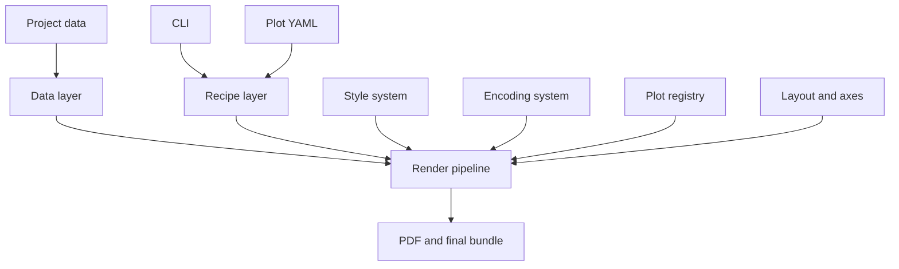

# CATPlot architecture

CATPlot separates scientific intent from Matplotlib implementation details.
Data mappings and plot options live in recipes; visual policy lives in styles;
individual renderer modules draw one coherent kind of mark.



## Dependency direction

The dependency direction is intentionally one-way:

1. `errors.py` and `types.py` depend only on the Python standard library.
2. `plots/base.py` defines the renderer contract.
3. Individual `plots/*/*.py` modules implement that contract.
4. `plots/registry.py` discovers implementations.
5. Data, encoding, style, axes, and layout prepare renderer inputs.
6. The render pipeline coordinates those pieces.
7. Recipe and CLI layers translate user intent into pipeline inputs.

Lower layers must never import the CLI, recipe loader, or render pipeline. This
prevents circular imports and keeps a single plot module understandable by
itself.

## Plot modules versus combinations

A module represents one drawing primitive, not every possible combination.
For example, several y columns are several uses of the line renderer; a right
y-axis changes the target axes; categorical markers are resolved by the marker
encoding layer. This prevents files such as
`multiple_colored_lines_with_category_markers.py`.

Every renderer is described by a `PlotSpec` and returns a `PlotResult`:

```python
SPEC = PlotSpec(
    name="line",
    family="cartesian",
    required_mappings=("x", "y"),
    optional_mappings=("group",),
    options={...},
)

@register_plot(SPEC)
def draw(*, ax, data, mapping, options, context):
    ...
    return PlotResult(artists=(line,))
```

The same specification will later generate CLI flags, validate YAML, and feed
documentation. A new plot type should therefore require one renderer file and
one focused test, not edits throughout the backend.

